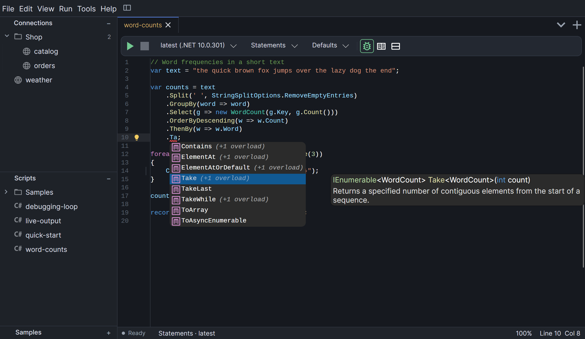

# Editor

The editor is the code area of a tab. Most of its intelligence comes from an in-process
Roslyn workspace that follows your text as you type. That workspace exists only for C#;
Visual Basic gets the lexical features described in [Visual Basic](#visual-basic).

<figure markdown="span">
  
  <figcaption>Syntax highlighting in a C# statement script.</figcaption>
</figure>

## Highlighting

- **Syntax highlighting** uses TextMate grammars for both languages. Choose the color
  theme in **Preferences → Interface → Editor theme**; the defaults are *Dark+* and
  *Light+*.
- **Semantic highlighting** (C#) colors identifiers by what they are after Roslyn has
  analyzed the code: types, interfaces, methods, properties, fields, events and
  namespaces each get their own color.
- **Occurrences** (C#): when the caret is on a symbol, the other uses of that symbol in
  the script are highlighted.
- **Brace matching** highlights the matching bracket. ++ctrl+bracket-right++ jumps to it.

## Completion

Completion (C#) opens automatically while you type:

- after `.` and `?.` for members, namespaces and static members;
- after `new ` for types you can construct, and after `override ` for members you can
  override (accepting one inserts a stub with a generated body);
- after `<` for generic type arguments;
- while you type an identifier or keyword.

Press ++ctrl+space++ to open it yourself. The list is filtered by context (no member
suggestions inside strings or comments, for example), members declared in your own
script are shown in bold, and overloads are collapsed into one entry.

!!! tip "Control-Space on macOS"
    macOS may use Control-Space to switch input sources. If the list does not open,
    rely on automatic completion or assign the input-source switch to a different key in
    **System Settings → Keyboard → Keyboard Shortcuts**.

**Automatic imports**: the list also offers types from namespaces that are not imported
yet, including types from the script's NuGet packages. Accepting one adds its namespace
to the `namespaces:` list in the front matter instead of inserting a `using` line.

**Commit characters**: with **Preferences → Editor → Accept completion when typing
punctuation** turned on (the default), typing punctuation such as `.`, `(` or `;` accepts
the selected item and then inserts the character. Space and `=` never accept an item.
With the option off, accept items with ++enter++, ++tab++ or a click.

### Snippets

In C#, type a snippet keyword and press ++tab++ to expand it. The caret lands where you
continue typing.

| Keyword | Expands to |
| --- | --- |
| `for`, `foreach`, `while`, `do` | Loops |
| `if`, `ife` | `if` and `if`/`else` |
| `try`, `tryf` | `try`/`catch (Exception ex)` and `try`/`finally` |
| `sw` | `switch` with a `case` and `default` |
| `prop`, `propg` | Auto-property with `set` or `private set` |
| `class`, `interface`, `ctor` | Type and constructor skeletons |
| `using`, `lock` | `using (var resource = …)` and `lock (…)` blocks |

## Signature help and quick info

- **Signature help** (C#) opens when you type `(` or `,` in a call, or with
  ++ctrl+shift+space++. It picks the overload that matches the arguments typed so far,
  highlights the current parameter and shows the XML documentation summary.
- **Quick info** (C#): rest the mouse pointer over a symbol for a moment to see its
  signature and documentation.
- **Inlay hints** (C#) show the inferred type next to `var` declarations and `foreach`
  variables. Turn them off in **Preferences → Languages → .NET → C#**.

## Navigation and refactoring

These commands work on the symbol under the caret in C# scripts. The table shows the
Windows and Linux defaults; see [Keyboard shortcuts](reference.md#keyboard-shortcuts)
for the macOS equivalents and custom bindings.

| Command | Key | What it does |
| --- | --- | --- |
| Go to Definition / Implementation | ++f12++ | If the symbol has implementations (for example an interface method), goes to the implementation, or shows a menu when there are several. Otherwise goes to the definition. A definition outside your script opens decompiled in the [Assembly Explorer](assembly-explorer.md). |
| Find References | ++shift+f12++ | Shows a menu of every line in the script that uses the symbol; pick one to jump there. |
| Rename | ++f2++ | Asks for a new name and renames every occurrence in the script as one undoable edit. |
| Format Document | ++shift+alt+f++ | Reformats the whole script with Roslyn's formatter. |
| Resolve All Usings | ++ctrl+alt+u++ | Adds the namespace for every unresolved type that has exactly one match. |
| Go to Line | ++ctrl+g++ | Asks for a line number and moves the caret there. |

++f2++ in the file tree renames the selected file instead; the key acts on whichever
panel has focus.

## Folding, display and zoom

- **Folding**: multi-line C# blocks fold at braces; a one-line `{ … }` block does not get
  a folding arrow. Visual Basic blocks fold at keyword pairs such as `Sub` … `End Sub`.
  Move the pointer over the folding column in the gutter to reveal the arrows for open
  blocks. A folded block keeps its arrow visible so you can expand it. Turn folding off
  in **Preferences → Editor → Show code folding**.
- **Display options** in **Preferences → Editor**: line numbers, visible tabs, spaces
  and line ends, a column ruler at column 80, word wrap, font size and font family.
- **Zoom**: hold ++ctrl++ (++cmd++ on macOS) and turn the mouse wheel, use **View → Zoom In**
  and **Zoom Out**, or use the percentage button at the
  right of the status strip. It offers *Zoom In*, *Zoom Out*, *Reset (100%)* and presets
  from 50% to 200% of the font size set in Preferences.

### Interface scale and shared code zoom

!!! info "Next release"
    The following controls are being prepared for the next release. They are not part
    of RunPad 0.5.0.

**Preferences → Interface → Interface scale** changes the size of the interface,
including code, results, panels, dialogs, icons and click targets. The default is 100%;
choose a preset from 90% to 200%. The native macOS menu bar keeps its system size.

Code zoom is an extra adjustment on top of the interface scale. It is shared by existing
and new editor tabs and separate code editor windows, and both settings are kept after
a restart. Use the wheel, **View → Zoom In / Zoom Out**, or the percentage button in the
status strip to change it. **Preferences → Editor → Code zoom** shows the current value.

For example, font size 12 with interface scale 125% and code zoom 110% gives an effective
code size of 16.5. Resetting interface scale leaves code zoom alone, and resetting code
zoom leaves interface scale alone. To return to the original sizes, reset both to 100%.

## Visual Basic

Visual Basic scripts compile, run and debug like C# scripts, and the editor provides
syntax highlighting, brace matching and keyword-based folding. There is no completion,
signature help, quick info, live diagnostics, quick fixes, semantic highlighting, inlay
hints, snippets, rename, navigation or formatting for Visual Basic yet. Compiler errors
appear in the Results tab when you run the script.
