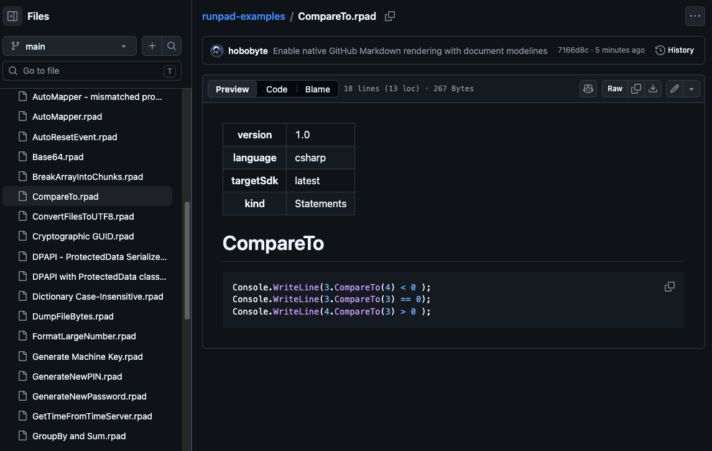

# The native C# scratchpad for .NET

Invoklet is a free, open-source C# scratchpad for Windows, macOS and Linux.

- Instantly run any C# snippet, statement block or program — press ++f5++
- Full IntelliSense: [completion with automatic imports, signature help, rename and Go to Definition](editor.md)
- [See problems as you type](analyzers.md): compiler errors, Roslyn analyzers and lightbulb fixes
- [Debug](debugging.md) with breakpoints, conditions, stepping, watches and exception breaks
- [Explore results with `.Dump()`](results.md): tables, live updates, progress bars and interactive input
- [Add NuGet packages](dependencies.md) with the built-in package manager, or reference any `.dll`
- [Read decompiled code](assembly-explorer.md) in an ILSpy-style Assembly Explorer
- [Import `.linq` queries](cli.md#importing-linq-queries) and run them with few or no changes
- [Markdown-compatible scripts](scripts.md): keep notes and runnable code together in `.inv` files,
  and read them as Markdown in [Invoklet's own preview](scripts.md#markdown-preview), in Obsidian or
  in repository previews
- [Find and replace](editor.md#find-and-replace), [run just the selected code](editor.md#running-a-selection-and-restarting),
  and pick up where you left off: open tabs and unsaved changes [come back after a restart](editor.md#recovering-unsaved-tabs)
- [View your scripts in Obsidian](obsidian.md): read and edit the notes and code of `.inv` files with the Invoklet Markdown plugin
- Native and fast: no embedded browser, scripts compile in-process with Roslyn
- Visual Basic scripts run and debug too
- Free and open source, on Windows, macOS and Linux

[Download Invoklet](https://github.com/tervforge/invoklet/releases){ .md-button }
[Quick start](quick-start.md){ .md-button }

<figure markdown="span">
  [](assets/screenshots/overview_light.png "Open full-size screenshot")
  [](assets/screenshots/overview.png "Open full-size screenshot")
</figure>

## A scratchpad for C\#

Each script is a `.inv` file: a Markdown document with a short YAML header and one
runnable code block. Write top-level statements, a `Main` program or a single expression;
Invoklet compiles it with the .NET SDK installed on your machine and shows the output and any
`.Dump()` results right under the editor. There is no project to set up and nothing to build
by hand.

## Markdown-compatible files

`.inv` is a **Markdown-compatible format**: a document containing a YAML metadata header,
Markdown notes and a fenced, runnable code block. Your code and its documentation stay
in one readable file that you can version, share and review.

You can view and edit these files in [Obsidian with the Invoklet Markdown plugin](obsidian.md),
or read them as Markdown on repository pages that support rendering the file type.
For a working GitHub example, open [CompareTo.inv in the examples repository](https://github.com/tervforge/invoklet-examples/blob/main/CompareTo.inv)
and select **Preview**. The file keeps its `.inv` extension; no separate `.md` copy is needed.

GitHub preview uses a Markdown file-type hint. Add this HTML comment at the end of the
file, outside the code block:

```html
<!-- vim: set filetype=markdown: -->
```

For repository highlighting and Markdown diffs, add `*.inv linguist-language=Markdown diff=markdown`
to `.gitattributes`.



The comment stays invisible in the rendered document. Repository rendering support varies
by host; GitLab's Markdown syntax-highlighting setting alone does not enable a rendered
`.inv` preview.

## Download

Invoklet runs on Windows, macOS (Apple Silicon and Intel) and Linux. Installers and
portable builds for every release are on the
[releases page](https://github.com/tervforge/invoklet/releases); the
[installation guide](install.md#download) explains which file to pick, and the
[changelog](changelog.md) lists what changed in each release.

## Start here

1. [Install Invoklet](install.md) and let the first-run setup find or install the .NET
   SDK and the `netcoredbg` debugger.
2. Follow the [quick start](quick-start.md) to run your first script and read its
   output.
3. Download the [examples](examples.md) to try the features described in this guide.

## C# and Visual Basic

Invoklet is built for C#. Visual Basic scripts compile, run and debug the same way, but
editor intelligence currently exists only for C#.

| Capability | C# | Visual Basic |
| --- | --- | --- |
| Run, kinds (Statements, Program, Expression) | Yes | Yes |
| Debugger (breakpoints, stepping, locals, watches) | Yes | Yes |
| NuGet packages, assembly references, namespaces | Yes | Yes |
| `.Dump()` and the Invoklet runtime helpers | Yes | Yes |
| Syntax highlighting, brace matching, folding | Yes | Yes (keyword-based folding) |
| Completion, signature help, quick info | Yes | No |
| Live diagnostics, analyzers, quick fixes | Yes | No (errors appear when you run) |
| Semantic highlighting, inlay hints | Yes | No |
| Rename, Find References, Go to Definition, Format Document | Yes | No |
| Snippets | Yes | No |

## Feedback and source code

Invoklet is free and open source under the GPL-3.0. The code is on
[GitHub](https://github.com/tervforge/invoklet); report bugs and suggest ideas in its
[issues](https://github.com/tervforge/invoklet/issues).
