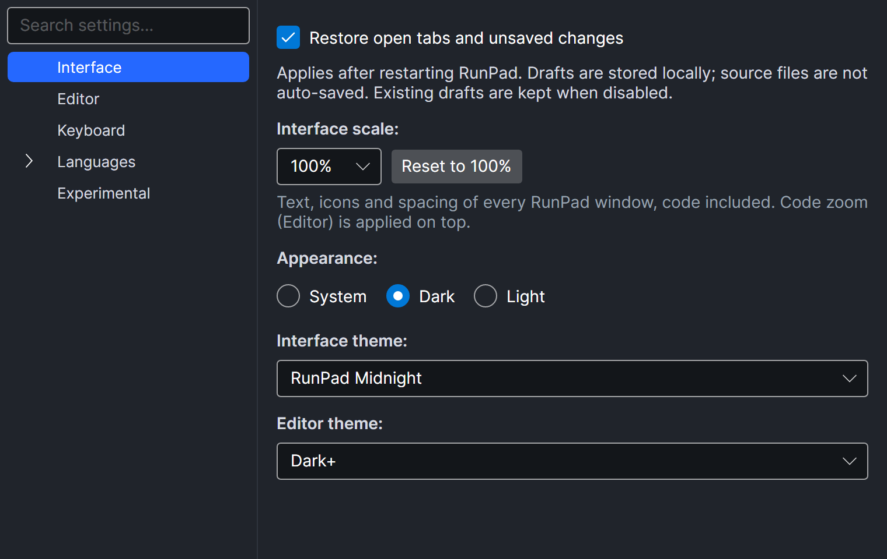

# Settings, shortcuts and troubleshooting

## Menu

The menu is the same on every system: at the top of the window on Windows and Linux, in the menu
bar on macOS. Every toolbar button and shortcut has a menu item too.

| Menu | Commands |
| --- | --- |
| **File** | New File, New RPad File, Open Text File..., Import LINQPad Query..., Save, Save As..., Close Tab, Exit |
| **Edit** | Undo, Redo, Cut, Copy, Paste, Select All, Format Document, Go to Line..., Resolve All Usings |
| **View** | Toggle File Tree, Toggle Output Panel, Zoom In, Zoom Out, Reset Zoom |
| **Run** | Run / Continue, Stop, Debug Mode, Step Over, Step Into, Step Out, Pause, Run to Cursor |
| **Tools** | Dependencies..., Assembly Explorer..., Preferences... |
| **Help** | User Guide, Release Notes, Report an Issue, About RunPad |

Each command shows its current shortcut, also in the macOS menu bar. **File → Exit** asks about
unsaved tabs and text editor windows before RunPad closes; on macOS it is also ++cmd+q++, which
works from every RunPad window. On macOS the menus hold only RunPad's commands: the application
menu has none of its own (About RunPad is under **Help**), and **Edit** has no AutoFill, Start
Dictation or Emoji & Symbols items — dictation and the character viewer are still available from
the system. Commands that work on a script, such as Run or Zoom In, act on the active tab.

## Preferences

Open **Tools → Preferences...**. Settings are grouped in a tree on the left; type in
*Search settings...* to filter it. Changes apply immediately.

<figure markdown="span">
  
  <figcaption>Preferences, with the Interface settings page selected.</figcaption>
</figure>

| Page | Settings |
| --- | --- |
| **Interface** | *Appearance*: System, Dark or Light. *Interface theme* and *Editor theme* for the current appearance (defaults: *VS Code Dark* / *VS Code Light* and *Dark+* / *Light+*). |
| **Editor** | Show line numbers, code folding, tabs, spaces, end of line, column ruler (column 80); word wrap; *Accept completion when typing punctuation*; font size and font family; *New file defaults (File → New File)*: language and kind. |
| **Keyboard** | Every key binding, grouped by area, with Reset and conflict warnings; see [Keyboard shortcuts](#keyboard-shortcuts). |
| **Languages → .NET** | *Dotnet path* (default `dotnet`, found on `PATH`) and *Debugger path* (the `netcoredbg` executable). Shared by C# and Visual Basic. |
| **Languages → .NET → C#** | *Inlay hints*; *Code fixes and refactorings (lightbulb)*; *Excluded diagnostic IDs*. See [Diagnostics and analyzers](analyzers.md#settings). |
| **Experimental** | Features that are not finished yet, all off by default: *RunPad analyzers* (`RPAD…` warnings). See [Diagnostics and analyzers](analyzers.md#four-kinds-of-analysis). |
| **Languages → .NET → Visual Basic** | No settings yet. |

## Keyboard shortcuts

Every shortcut can be changed in **Tools → Preferences... → Keyboard**. The page lists each
command with its key; type a new combination such as `Ctrl+Shift+R`, `Cmd+,` or `F6`, or clear
the field to remove the key. **Reset** brings back the default, and a warning appears under a
key that another command already uses where the same keypress reaches both (a file-tree key may
repeat an editor key, an Assembly Explorer key a main-window one). A changed key takes effect at
once, in the menu and in every open window. Only the keys you change are stored in `settings.json`.

The defaults follow LINQPad (and Visual Studio, whose debugging keys LINQPad shares), so
LINQPad habits carry over. On macOS, the Command key (++cmd++) takes the place of Control
where that is the Mac convention.

### General

| Command | Windows and Linux | macOS |
| --- | --- | --- |
| New File | ++ctrl+n++ | ++cmd+n++ |
| Save | ++ctrl+s++ | ++cmd+s++ |
| Save As | ++ctrl+shift+s++ | ++cmd+shift+s++ |
| Close Tab | ++ctrl+w++ | ++cmd+w++ |
| Exit | — (the system's ++alt+f4++) | ++cmd+q++ |
| Dependencies | ++f4++ | ++f4++ |
| Preferences | — | ++cmd+comma++ |
| Toggle Output Panel | ++ctrl+r++ | ++cmd+r++ |
| Assembly Explorer, Toggle File Tree, Zoom In, Zoom Out, Reset Zoom | — | — |

### Run and debug

| Command | Windows and Linux | macOS |
| --- | --- | --- |
| Run / Continue | ++f5++ | ++f5++ |
| Stop | ++shift+f5++ | ++shift+f5++ |
| Step Over | ++f10++ | ++f10++ |
| Step Into | ++f11++ | ++f11++ |
| Step Out | ++shift+f11++ | ++shift+f11++ |
| Run to Cursor | ++ctrl+f10++ | ++cmd+f10++ |
| Debug Mode, Pause | — | — |

On macOS, function keys may need the ++fn++ key, depending on your keyboard settings.

### Editor

| Command | Windows and Linux | macOS |
| --- | --- | --- |
| Show Completion | ++ctrl+space++ | ++ctrl+space++ |
| Signature Help | ++ctrl+shift+space++ | ++cmd+shift+space++ |
| Go to Definition / Implementation | ++f12++ | ++f12++ |
| Find References | ++shift+f12++ | ++shift+f12++ |
| Rename Symbol | ++f2++ | ++f2++ |
| Jump to Matching Bracket | ++ctrl+bracket-right++ | ++ctrl+bracket-right++ |
| Format Document | ++shift+alt+f++ | ++shift+alt+f++ |
| Go to Line | ++ctrl+g++ | ++ctrl+g++ |
| Resolve All Usings | ++ctrl+alt+u++ | ++cmd+alt+u++ |

### File tree

| Command | Windows and Linux | macOS |
| --- | --- | --- |
| Rename | ++f2++ | ++enter++ |
| Delete | ++del++ | ++cmd+backspace++ |

### Assembly Explorer

| Command | Windows and Linux | macOS |
| --- | --- | --- |
| Back / Forward | ++alt+left++ / ++alt+right++ | ++cmd+bracket-left++ / ++cmd+bracket-right++ |
| Search Types and Members | ++ctrl+shift+f++ | ++cmd+shift+f++ |
| Analyze | ++ctrl+r++ | ++cmd+r++ |
| Remove Assembly | ++del++ | ++cmd+backspace++ |
| Next / Previous Tab | ++ctrl+tab++ / ++ctrl+shift+tab++ | ++ctrl+tab++ / ++ctrl+shift+tab++ |

Save and Close Tab use the General keys above.

### Keys that follow the system

These are not listed in Preferences: text editing uses the platform's own keys (Undo, Redo,
Cut, Copy, Paste, Select All — with ++cmd++ on macOS), ++tab++ expands a snippet, and holding
++ctrl++ (++cmd++ on macOS) while turning the mouse wheel zooms the editor or while clicking a
name in the Assembly Explorer goes to its definition.

## Where RunPad stores data

| What | Location |
| --- | --- |
| Your scripts | `RunPad Queries` in your Documents folder |
| Settings | `settings.json` in RunPad's data folder |
| NuGet sources | `NuGet.Config` in RunPad's data folder |
| Debugger installed by the setup window | `netcoredbg` folder in RunPad's data folder |
| Files written by `Util.Cache` and `Util.SaveString`/`SaveBytes` | `UserData` folder in RunPad's data folder |
| Logs | `logs` folder in RunPad's data folder |
| Build output | `RunPad` folder in the system temporary folder. A saved script keeps its build folder between runs; folders unused for 14 days are removed when RunPad starts. |

RunPad's data folder is:

| System | Folder |
| --- | --- |
| Windows | `%APPDATA%\RunPad` |
| macOS | `~/Library/Application Support/RunPad` |
| Linux | `~/.config/RunPad` (or `$XDG_CONFIG_HOME/RunPad`) |

## Troubleshooting

### No .NET SDK found

Symptoms: the setup window shows ❌ next to *.NET SDK*, the SDK drop-down in the toolbar
is empty and Run does nothing, or the command-line runner prints
`No .NET SDK found (checked dotnet --list-sdks).`

- Run `dotnet --list-sdks` in a terminal. RunPad needs at least one SDK of version 6 or
  newer.
- If the SDK is installed but not on `PATH` for desktop apps (common when RunPad is
  started from the macOS Dock or Finder), set the full path in
  **Preferences → Languages → .NET → Dotnet path**, for example
  `/usr/local/share/dotnet/dotnet` on macOS or `C:\Program Files\dotnet\dotnet.exe` on
  Windows.
- Or restart RunPad and use **Install** in the setup window.

### The debugger does not start or breakpoints are ignored

See [Debugging → Troubleshooting](debugging.md#troubleshooting).

### "Invalid document"

The file is not a valid `.rpad` document: the front matter is missing or not closed, the
YAML is invalid, a `kind` or `language` value is not supported, or there is no run block
for the declared language. The Results tab explains which. See
[Scripts and .rpad files](scripts.md#front-matter).

### A package cannot be restored

Check the package ID and version, and that a source in
[Package sources](dependencies.md#package-sources) has the package and is reachable.
Restore warnings and errors are printed in the Results tab.

### `Project references are no longer supported`

Reference the project's built `.dll` instead. See
[Project references are not supported](dependencies.md#project-references-are-not-supported).

### macOS refuses to open RunPad

The build is not signed or notarized yet. See [Installation → macOS](install.md#macos).

### No completion or underlines

These features exist only for C#. Check the `language` of the script; Visual Basic has
no live analysis yet. For C#, give the background analysis a moment after typing, and
check that the file is a valid document.
